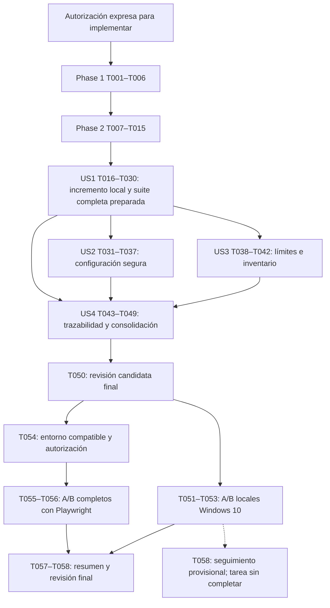

# Tasks: F00 — Bootstrap del proyecto FarmaFind

**Input**: documentos de `specs/001-f00-bootstrap-proyecto/`.
**Prerequisites**: [spec.md](spec.md) aclarada y aprobada; [plan.md](plan.md) corregido y
complementarios aprobados expresamente el 2026-11-10; Constitution v1.1.0 ratificada.
**Created**: 2026-11-10. **Status**: implementación técnica local parcial autorizada;
53 tareas implementadas o verificadas según su redacción y 5 pendientes (T054–T058).
Se conservan los 58 identificadores; ninguna marca acredita aceptación completa.
La invocación inicial de speckit-tasks autorizó únicamente este documento. Posteriormente,
el usuario autorizó expresamente speckit-implement solo para T001, T002 y la parte de T004
independiente de T003. No autorizó instalaciones, navegadores, servidores, pruebas de
aplicación, commits, push, Pull Requests, despliegues ni tareas adicionales.

**Autorización posterior — incremento de arranque local:** el usuario autorizó resolver
T003/T004 y sus dependencias necesarias hasta el arranque técnico local con verificaciones
Windows 10, incluyendo preparación de paquetes gratuitos y pruebas locales. Se mantienen
prohibidos negocio, infraestructura, commits y cambios en main. La revisión previa de T003
detectó avisos en Vitest 4.0.18 y Vite 7.3.6. El usuario aprobó expresamente los parches
4.1.12 y 7.3.8, respectivamente. Se generó lockfile, instaló el árbol y se ejecutaron
controles locales autorizados. Ver
[revisión de dependencias](../../docs/evidencias/f00/dependency-review.md).

**Tests**: incluidos porque F00-FR-013/014/018, sus aclaraciones y F00-SC-001/002/004/007
exigen comprobaciones automáticas. Escribir un test no equivale a ejecutarlo; ejecutarlo
localmente no acredita UI ni aceptación completa.
**Organization**: preparación y fundamentos compartidos, cuatro historias en el orden
P1/P1/P2/P2 de spec.md, y cierre transversal. Las 58 casillas se generaron sin marcar;
el estado actual distingue entregables terminados, tareas parciales y aceptación pendiente.

## Format: `[ID] [P?] [Story] Description`

- `[P]` identifica archivos distintos que pueden trabajarse simultáneamente después de
  satisfacer las dependencias indicadas; no autoriza lanzar agentes o ejecutar tareas ahora.
- `[US1]`–`[US4]` corresponden a las historias aprobadas; no son funcionalidades adicionales.
- Cada tarea incluye rutas relativas a la raíz del repositorio. Las rutas de aplicación,
  fixtures y evidencia son entregables de las tareas indicadas; solo algunos existen hoy.
- No se añaden servicios activos de BD, caché, IA o nube, modelos de negocio, autenticación,
  políticas SQL, Dockerfiles, Compose, workflows remotos ni E2E de negocio.

## Path Conventions

`frontend/`: React/Vite/JSX; `backend/`: Express/TypeScript y núcleo modular;
`notifications/`: proceso Express/TypeScript independiente; `scripts/f00/`: herramientas
Node ESM portables; `tests/bootstrap/` y `tests/fixtures/`: verificaciones técnicas.
`artifacts/f00/<run-id>/`: salidas privadas locales, excluidas del control de versiones.
`docs/evidencias/f00/`: guías y resúmenes sintéticos revisados; no documentos históricos.

Fuentes vinculantes: [research.md](research.md), [data-model.md](data-model.md),
[quickstart.md](quickstart.md), [OpenAPI](contracts/bootstrap.openapi.yaml),
[configuración](contracts/local-configuration.md), [validación](contracts/validation.md)
y [trazabilidad](evidence-traceability.md). Las restricciones citadas literalmente más
abajo proceden del modelo técnico; no introducen tablas ni entidades de negocio.

## Phase 1: Setup — preparación compartida

**Purpose**: preparar las herramientas y el árbol aprobado únicamente después de una
autorización expresa de implementación. Windows 10, PowerShell 5.1, VS Code, Codex,
Spec Kit, Node.js 24.17.0 y npm 11.13.0 permanecen como referencias; no instalar otro SO.

- [X] T001 Registrar en `README.md` los prerrequisitos Windows 10, versiones de referencia, rama distinta de main y límites de autorización; enlazar spec/plan aprobados y pendientes Playwright/RC04/ADR, sin presentar F00 como implementada o validada. Detener el trabajo ejecutable mientras no exista autorización expresa de implementación.
- [X] T002 Crear `package.json`, `frontend/package.json`, `backend/package.json` y `notifications/package.json` privados con npm workspaces y las versiones directas exactas del plan/research; conservar JSX en frontend y TypeScript en los procesos Node, sin SQL/Redis/ORM/IA ni gestores adicionales. Declarar Playwright como herramienta diferida y evitar scripts de instalación que preparen Chromium automáticamente.
- [X] T003 Revisar disponibilidad, engines/peers y avisos de las versiones aprobadas y generar `package-lock.json` raíz y `docs/evidencias/f00/dependency-review.md` mediante preparación autorizada; registrar versiones realmente resueltas, sin declarar seguridad o funcionamiento no comprobados. Si requiere cambiar una selección aprobada, presentar la diferencia y obtener aprobación antes de adoptarla; congelar el árbol antes de A/B.
- [X] T004 Preparar `.gitignore` y `.npmrc` sin credenciales para excluir `node_modules`, `dist`, `.env.local`, informes privados y `artifacts/f00/`; fijar dependencias reproducibles, no ocultar scripts ausentes con tolerancia a fallos ni añadir publicación o despliegue automático.

**Resultado T003/T004:** los parches Vite 7.3.8 y Vitest 4.1.12 fueron aprobados e
instalados mediante lockfile raíz. `npm audit` informó 0 vulnerabilidades en el árbol
instalado en la revisión efectuada. `.gitignore` y `.npmrc` se contrastaron con ese
árbol y no contienen credenciales. La reproducción completa A/B permanece pendiente.

- [X] T005 [P] Preparar `frontend/vite.config.js` y `frontend/index.html` para React/JSX, recursos locales, loopback y puertos estrictos; mantener desarrollo 5173 y preview 4173, sin fuentes/CDN externos ni configuración privada publicada. Depende de T002.
- [X] T006 [P] Preparar `backend/tsconfig.json`, `notifications/tsconfig.json` y `vitest.config.mjs` para TypeScript estricto/NodeNext, salida dist y pruebas técnicas; separar explícitamente la selección Vitest del directorio Playwright para que los controles locales no lo importen ni lo ejecuten. Depende de T002.

**Checkpoint**: manifiestos/configuración base preparados, sin negocio ni aceptación
acreditada. La descarga autorizada de dependencias es preparación; los controles
posteriores deben funcionar sin servicios externos ni descargas implícitas.

## Phase 2: Foundational — prerrequisitos comunes bloqueantes

**Purpose**: contratos técnicos, validación mínima y registro comunes a las historias.
No iniciar las historias hasta completar estos fundamentos; no confundirlo con crear
infraestructura de negocio. Los tests se redactarán antes de su código correspondiente;
su ejecución futura debe distinguir fallo esperado del fixture de fallo real de la suite.

- [X] T007 [P] Redactar `tests/bootstrap/reporting.test.mjs` con fixtures en `tests/fixtures/reports/` para registros incompletos, estados inválidos, fallos junto con pendientes, interrupción/limpieza, reportes inmutables y separación entre ejecución y par A/B; cubrir failed > pending > passed y rechazar overall passed local o acceptance passed individual. Añadir casos para la utilidad `scripts/f00/source-manifest.mjs`: un mismo árbol produce los mismos hashes; un cambio de fuente produce un resultado distinto; los cambios en salidas de evidencia o archivos excluidos no alteran el hash de fuente. No generar reportes reales ficticiamente verdes.
- [X] T008 [P] Redactar `tests/bootstrap/configuration.test.mjs` y perfiles ficticios en `tests/fixtures/config/` para mínima válida/ausente/inválida en los tres componentes, sin servicios externos, secretos ni modificación del perfil privado del usuario. Depende de Phase 1, independiente de T007.
- [X] T009 [P] Definir la representación técnica en `scripts/f00/component.mjs` con las restricciones literales: componentId «frontend, farmafind-api o farmafind-notifications; único dentro de una preparación.»; role «SPA estática, núcleo modular o proceso independiente.»; host «127.0.0.1 para aceptación F00.»; port «1–65535, distinto para cada proceso y libre al iniciar.»; mode «Solo bootstrap; no modo producción o negocio en F00.»; lifecycle «not_started, starting, running, stopping, stopped o failed.»; observableCheck «pending, passed o failed; no derivado solamente de lifecycle.»; processOwnership «PID y proceso lanzado por el supervisor; nunca un PID ajeno usado por nombre.» Conservar las transiciones del modelo y un fallo previo aunque la limpieza pase. Depende de T007.
- [X] T010 [P] Definir el perfil técnico en `scripts/f00/config-profile.mjs` con las restricciones literales: profileId «Preparación + componente; no identidad personal.»; variables «Nombre, tipo, obligatoriedad, visibilidad y validación.»; visibility «public, private o future_disabled.»; source «Ejemplo versionado o archivo local privado; nunca se registra contenido secreto.»; validation «valid o rejected; errores incluyen nombre y causa, no valor privado.» No construir un almacén compartido de negocio. Depende de T008.
- [X] T011 [P] Definir metadatos de preparación en `scripts/f00/preparation.mjs` con las restricciones literales: preparationId «A o B, dos registros distintos de la misma revisión.»; sourceRevision «Commit cuando exista; además hash de árbol/manifest y lockfile. Nunca inventar un SHA si no hay commit.»; workingDirectory «Copia separada del árbol; no contiene secretos o outputs de la otra. Se redacta el usuario de rutas si se publican.»; platform «Windows edición/build/arquitectura, shell, Node, npm, paquetes y navegador.»; prerequisites «Herramientas del grupo local preparadas; navegador solo obligatorio para el grupo completo en entorno oficialmente compatible. Su ausencia no bloquea el grupo Windows 10.»; actor «Puede ser el mismo en A y B; no DNI, correo personal o identificación médica.»; status «pending, prepared, validating, passed o failed.» No compartir node_modules, dist, perfiles o resultados entre A y B. Crear también `scripts/f00/source-manifest.mjs` como utilidad local de lectura para obtener hashes deterministas de fuente, instrucciones, manifiestos y lockfile; excluir .git, secretos, node_modules, dist y salidas de evidencia. No crear commits ni inventar SHA. La utilidad puede identificar una revisión de trabajo sin declararla candidata congelada ni preparación A/B aceptada. Depende de T007.
- [X] T012 Implementar el registro conceptual en `scripts/f00/report.mjs` con las restricciones literales: runId «F00 + preparación + instante UTC; no contiene secretos.»; preparationId «A o B existente.»; scope «local o complete; distingue verify:local de verify:bootstrap y no altera las obligaciones completas.»; requirementIds «Referencias F00-FR, F00-SC y criterios de rúbrica asociados.»; commands «Comando, directorio, inicio/fin, código de salida; no valores secretos como argumentos.»; versions «Herramientas, paquetes, navegador y hashes de manifiestos/lock.»; expected «Condición documentada antes de ejecutar.»; actual «Valor observado, identificador de componente y duración; no credenciales.»; errors «Incidencias reales o declaración explícita none si no ocurrieron.»; artifacts «JSON/texto, resultados HTTP y captura de pantalla técnica con rutas relativas.»; cleanup «PIDs propios cerrados/puertos liberados; pendiente o fallo impide éxito global.» Marcar navegador/captura no ejecutados como pendientes y no inventarlos. Depende de T009/T011.
- [X] T013 Implementar la agregación en `scripts/f00/report-states.mjs` citando local «pending, passed o failed para los controles obligatorios del subconjunto local de esa ejecución.»; overall «pending, passed o failed para todos los controles obligatorios de esa ejecución completa, incluidos UI y limpieza.»; acceptance «pending en el registro individual; se determina para F00 en un resumen del par A/B con las reglas siguientes.» Aplicar íntegramente el contrato común: failed > pending > passed; sin UI no hay overall passed; ausencia de prerrequisito sin fallo real es pending; un fallo de limpieza afecta a su conjunto. Conservar reportes anteriores y estados por preparación. Depende de T007/T012.
- [X] T014 Implementar la validación mínima propia de arranque en `backend/src/config/index.ts`, `notifications/src/config/index.ts` y `scripts/f00/frontend-config.mjs`: APP_MODE/HOST/PORT requeridos en Node, bootstrap/127.0.0.1/puerto válido y distinto; frontend VITE_APP_MODE=bootstrap y puertos privados del lanzador fuera del bundle. Leer perfiles explícitos mediante Node 24, rechazar ausencia/invalidez sin defaults silenciosos ni valores secretos; preservar entorno mínimo de Windows sin heredar integraciones accidentalmente. Depende de T008/T010.
- [X] T015 Preparar `scripts/f00/check.mjs` y `scripts/f00/check-config.mjs` y conectar los controles básicos en `package.json`: sintaxis JS, tipos TS, revisión inicial de imports y fixtures de configuración, sin importar Playwright ni conectar integraciones. Sin npx con descarga, --if-present o control ausente convertido en éxito. Depende de T006–T014.

**Checkpoint**: configuración mínima y contratos de evidencia disponibles para comprobar
historias. Las entidades son metadatos técnicos en memoria/archivos, nunca tablas SQL.

## Phase 3: User Story 1 — Preparar y comprobar el entorno local (Priority: P1)

**Goal**: tres componentes técnicos identificables con arranque/parada independientes.
**Independent Test**: desde una copia limpia, controles locales Windows 10 de build,
configuración, HTTP e independencia, con reporte y limpieza. La historia exige además
pantalla real Playwright y dos preparaciones completas: su aceptación permanece pendiente
hasta T055/T056, aunque el subconjunto local pase. Escenarios US1.1–US1.3; FR001/002/005/006/013/018.

### Tests for User Story 1 — exigidos por la especificación

- [X] T016 [P] [US1] Redactar `frontend/tests/bootstrap.spec.js` para Playwright: HTTP 200, encabezado visible exacto “FarmaFind — Bootstrap”, marcador “Modo técnico: sin funcionalidades de negocio”, montaje React y recursos obligatorios sin errores; rechazar HTML vacío/PID vivo como éxito y bloquear destinos fuera de loopback/service workers. Su ejecución queda bloqueada hasta un Windows oficialmente compatible autorizado.
- [X] T017 [P] [US1] Redactar `backend/tests/health.test.ts` con Vitest/Supertest contra `specs/001-f00-bootstrap-proyecto/contracts/bootstrap.openapi.yaml`: GET /health, 200, application/json, Cache-Control no-store, objeto exacto service=farmafind-api/status=ok/mode=bootstrap y sin propiedades extra; rutas no definidas 404, sin negocio ni acceso de datos.
- [X] T018 [P] [US1] Redactar `notifications/tests/health.test.ts` con las mismas restricciones OpenAPI y service=farmafind-notifications, rechazando identidad API, mensajes o eventos usados para responder salud; instancia y configuración independientes del backend.
- [X] T019 [P] [US1] Redactar `tests/bootstrap/processes.test.mjs` y `tests/fixtures/processes/listener.mjs` para colisión de puerto propio, servidor ajeno/no reutilizable, identidad incorrecta, timeout, parada/reinicio individual, limpieza interrumpida/fallida, rutas Windows con espacios y persistencia de fallos; nunca matar procesos ajenos o todos los node.exe.
- [X] T020 [P] [US1] Redactar `tests/bootstrap/browser-separation.spec.js` y `tests/fixtures/browser/blank.html` para continuidad visible de UI/API al detener Notificaciones, UI/Notificaciones al detener API y API/Notificaciones al detener preview; negativos de marcador ausente, montaje/recurso fallido y endpoint incorrecto. Ejecución pendiente de entorno oficialmente compatible; no sustituir por capturas manuales.

### Implementation for User Story 1 — incremento técnico local autorizado

- [X] T021 [P] [US1] Crear `frontend/src/main.jsx` y `frontend/src/Bootstrap.jsx` con la pantalla técnica exigida en T016, sin datos de negocio, peticiones obligatorias a API, recursos remotos o variables privadas; frontend sigue JavaScript/JSX y conserva configuración validada. Depende de T016 y fundamentos.
- [X] T022 [P] [US1] Crear `backend/src/app.ts` y `backend/src/bootstrap/health.ts` para composición Express y /health técnico exacto de T017, sin casos de uso de negocio, repositorios, clientes externos o declaraciones de salud de integraciones. Depende de T017 y fundamentos.
- [X] T023 [P] [US1] Crear `notifications/src/app.ts` y `notifications/src/bootstrap/health.ts` como aplicación Express independiente con contrato de T018; no importar la instancia API, enviar mensajes, consumir/publicar eventos o compartir configuración mutable. Depende de T018 y fundamentos.
- [X] T024 [US1] Crear `backend/src/main.ts` y `notifications/src/main.ts` para arranque explícito compilado, validación antes de escuchar, fallo ante puerto ocupado y cierre acotado propio; no hot reload obligatorio ni tsx/daemon global. Depende de T022/T023/T014.
- [X] T025 [US1] Implementar `scripts/f00/process-supervisor.mjs` y `scripts/f00/http-checks.mjs` para lanzar artefactos Node y CLI Vite directamente con argumentos separados, registrar PIDs propios, validar identidad y disponibilidad estática parcial, detener/reiniciar y limpiar en finally/interrupción. Aplicar 60 s/inicio, 5 s/HTTP y 10 s/limpieza; verificar propiedad antes de terminar descendientes propios Windows. Depende de T019/T021–T024 y contratos técnicos.
- [X] T026 [US1] Implementar `scripts/f00/verify-local.mjs` para --preparation A/B, revisión/hashes, perfiles propios y puertos estrictos; orquestar check/check:config/test:base/build, HTTP y separación de tres procesos sin importar ni lanzar Playwright. Reportar scope local, local passed/failed/pending y overall/acceptance conforme T013; salida 0 solo por éxito local, limpieza obligatoria, UI pendiente explícita. Obtener revisión/hashes mediante la utilidad creada en T011; no depender de T050 para ejecutar comprobaciones iniciales ni presentar esas comprobaciones como aceptación de una candidata congelada. Depende de T011/T025/T013/T015.
- [X] T027 [US1] Implementar `scripts/f00/verify-bootstrap.mjs` como entrada completa separada: preflight de Windows/navegador oficialmente compatibles sin descargar lo ausente, controles locales más Playwright, negativos y limpieza. Si falta prerrequisito, UI pending y salida 1; conservar cualquier fallo observado como failed. Solo overall passed con scope complete permite salida 0 y acceptance individual sigue pending. No ejecutar en Windows 10 suponiendo soporte. Depende de T020/T025/T026.
- [X] T028 [US1] Preparar `playwright.config.js` con selección explícita de T016/T020, Chromium local ya preparado, sin reutilizar servidores, aserción DOM 10 s, solicitudes solo loopback y fixtures de procesos propios; el prerrequisito ausente nunca se convierte en skip verde. Mantener esta configuración fuera de la importación del grupo local. Depende de T016/T020/T027.
- [X] T029 [US1] Completar `package.json` y los tres manifiestos workspace con dev:web, dev:api, dev:notifications, build, check, check:config, test:base, verify:local, browser:install y verify:bootstrap según el contrato; scripts locales resuelven binarios instalados, no descargan implícitamente. browser:install queda exclusivamente para preparación posterior compatible autorizada. Depende de T021–T028; actualizar lockfile solo si cambian dependencias y antes de fijar A/B.
- [X] T030 [US1] Ejecutar, solo bajo autorización de implementación/ejecución, los tests locales y una comprobación de integración técnica en Windows 10; guardar comandos, expectativas, versiones, resultados y limpieza en `artifacts/f00/<run-id>/`. Demostrar negativos de puerto/identidad/ruta con espacios y separación por HTTP, dejando UI/aceptación pending; no confundir esta comprobación con las dos preparaciones finales T051/T052 ni con T055/T056. Depende de T029.

**Alcance de las marcas T016/T020/T027–T030:** se redactaron pruebas y entradas de
Playwright y se verificó únicamente su descubrimiento y el preflight pendiente en
Windows 10. Las pruebas de navegador no se ejecutaron. T030 corresponde solo a la
ejecución del grupo local; T054–T057 y la aceptación completa continúan pendientes.

**Checkpoint**: incremento técnico verificable localmente. No marcar completada la
aceptación de US1 ni F00 mientras falten UI y A/B completos; seguir con trabajo local
autorizado no convierte esas tareas pendientes en realizadas.

## Phase 4: User Story 2 — Configurar el proyecto sin exponer información (Priority: P1)

**Goal**: inventario completo de variables, ejemplos ficticios, rechazo seguro y aislamiento
de configuración de prueba. **Independent Test**: perfiles válida/ausente/inválida por
componente producen expectativas distintas, sin imprimir secretos ni usar integraciones;
pueden probarse con fixtures y lanzadores de configuración sin depender de UI.
Escenarios US2.1–US2.3; FR006/007/008/011/018/020; SC003/004.

### Tests for User Story 2

- [X] T031 [P] [US2] Ampliar `tests/bootstrap/configuration.test.mjs` y `tests/fixtures/config/` con PORT vacío/no numérico/fuera de rango/duplicado, HOST no admitido, APP_MODE distinto, VITE_APP_MODE ausente/inválido y variables privadas heredadas contradictorias; comprobar rechazo antes de publicar salud, nunca defaults silenciosos. Los perfiles son temporales y propios, no .env.local del usuario.
- [X] T032 [P] [US2] Redactar `tests/bootstrap/configuration-security.test.mjs` con marcadores ficticios reconocibles para comprobar que errores, bundle público y reportes no exponen configuración privada y que DATABASE_URL/REDIS_URL/IA/AWS presentes o ausentes no activan conexiones ni simulan disponibilidad; registrar límites de esta prueba sin presentarla como auditoría exhaustiva del SO.

### Implementation for User Story 2

- [X] T033 [P] [US2] Crear `frontend/.env.example`, `backend/.env.example` y `notifications/.env.example` y catálogo en `docs/evidencias/f00/configuration.md` con nombre, propósito, clasificación, obligatoriedad, ejemplo ficticio y validación; frontend solo VITE_APP_MODE público, HOST/puertos del supervisor privados al lanzador y catálogo futuro comentado/deshabilitado. No crear credenciales reales ni URLs de producción. Depende de fundamentos y contrato de configuración.
- [X] T034 [US2] Completar `backend/src/config/index.ts`, `notifications/src/config/index.ts` y `scripts/f00/frontend-config.mjs` con todos los casos T031/T032, perfil explícito y precedencia segura; mantener entorno mínimo Windows para procesos y excluir variables de integración del arranque F00. No crear modos operativos de BD/caché/IA. Depende de T031–T033 y T014.
- [X] T035 [US2] Incorporar redacción de errores/valores privados/rutas personales publicables en `scripts/f00/report.mjs` y salidas de `scripts/f00/check-config.mjs`; usar componente, nombre y causa, sin volcar .env o entorno completo. No cambiar estados ni borrar fallos históricos. Depende de T032/T034/T012.
- [X] T036 [US2] Completar la ejecución automática de fixtures en `scripts/f00/check-config.mjs` y controles de seguridad en `scripts/f00/check.mjs`, integrados con check/test:base sin navegador; asegurar códigos 0/1 inequívocos y que una prueba negativa pasa solo al obtener el rechazo esperado. Depende de T031–T035 y T029.
- [X] T037 [US2] Ejecutar únicamente con autorización los casos US2 y comprobaciones de secretos ficticios, registrando resultados esperados/obtenidos y errores o none en `artifacts/f00/<run-id>/`; incluir configuración pública/privada, integración ausente y perfil real del usuario intacto. No registrar servicios futuros como disponibles ni atribuir esta evidencia a Playwright. Depende de T036.

**Checkpoint**: configuración y protección comprobadas localmente cuando haya resultados
reales. SC003/004 no se acreditan por escribir ejemplos o tests sin ejecutarlos.

## Phase 5: User Story 3 — Reconocer responsabilidades y límites del bootstrap (Priority: P2)

**Goal**: identificar cuatro capas, siete módulos, ampliación IA y Notificaciones sin
implementar negocio. **Independent Test**: revisión de inventario/imports y exposición
técnica, sin arrancar BD/caché, sin casos de uso de negocio y sin depender de navegador.
Escenarios US3.1–US3.3; FR002/003/004/009–012/015/016; SC005/006.

### Tests for User Story 3

- [X] T038 [US3] Redactar `tests/bootstrap/architecture.test.mjs` con fixtures en `tests/fixtures/architecture/` que rechacen dominio importando Express/detalles externos, módulos privados importados fuera de contratos, Notificaciones importando la instancia API, drivers/ORM/Redis/IA o rutas de negocio incorporadas al bootstrap; no exigir carpetas/interfaces vacías para pasar ni afirmar RLS probado por este control.

### Implementation for User Story 3

- [X] T039 [P] [US3] Documentar en `backend/src/modules/README.md` las ubicaciones reservadas usuarios, farmacias, medicamentos, busqueda, inventario, reservas y administracion con nombres históricos completos; cuatro capas domain/application/presentation/infrastructure al activar cada módulo, dependencias hacia adentro y contratos públicos. Distinguir asistente-ia como futura ampliación informativa, sin crear operaciones, proveedor/mock ni carpetas vacías obligatorias. Depende de fundamentos/T038.
- [X] T040 [US3] Completar `scripts/f00/check-architecture.mjs` y conectarlo en `scripts/f00/check.mjs` para revisar las restricciones de T038 y separar salud de dominio; reportar comprobaciones y exclusiones reales, sin dar por implementado un módulo por existir una ruta reservada. Depende de T038/T039 y T015.
- [X] T041 [P] [US3] Documentar en `backend/README.md`, `notifications/README.md` y `frontend/README.md` límites actuales y futuros: PostgreSQL oficial, membresías/rol/recurso/farmacia/contexto transaccional/RLS sin BYPASSRLS, Redis Cache-Aside con TTL/invalidation postcommit/fallback, UoW/Outbox y Notificaciones posterior al commit; AWS S3 privado/CloudFront OAC/Lightsail y Docker/Compose posteriores. Sin conexiones, transacciones, eventos, mensajes, diagnósticos, dosis o disponibilidad inventada; conservar IDs históricos y pendientes RC04/ADR. Depende de fundamentos/T038; archivos distintos de T039/T040.
- [X] T042 [US3] Ejecutar bajo autorización los controles de arquitectura y revisar la exposición limitada a pantalla bootstrap y endpoints técnicos; registrar inventario, límites de cuatro capas, ampliación IA y separación de Notificaciones en `artifacts/f00/<run-id>/architecture-review.md`. No declarar seguridad multi-tenant operativa, reservas o integraciones probadas. Depende de T039–T041 y endpoints de US1.

**Checkpoint**: continuidad arquitectónica verificable, sin sustituir las futuras pruebas
de autorización/RLS, Redis, transacciones, deduplicación o IA.

## Phase 6: User Story 4 — Revisar calidad, trazabilidad y aprobación (Priority: P2)

**Goal**: revisar requisitos y evidencia sin atribuir cumplimiento inexistente y preparar
una aceptación reproducible. **Independent Test**: fixtures de reportes/pares permiten
probar rechazo de falsa aceptación sin navegador; la aceptación con reportes reales
depende de completar US1–US3 y las dos preparaciones completas finales.
Escenarios US4.1–US4.3; FR013/014/016–020; SC001/006/007 y revisión de todos los SC.

### Tests for User Story 4

- [X] T043 [P] [US4] Redactar `tests/bootstrap/acceptance-summary.test.mjs` con fixtures sintéticos identificados en `tests/fixtures/reports/pairs/` para par ausente, solo local, revisión distinta, independencia no acreditada, fallo junto con pending, evidencia obligatoria incompleta y par completo satisfactorio; nunca confundir esos fixtures con preparaciones reales ni reescribir sus reportes.
- [X] T044 [P] [US4] Redactar `tests/bootstrap/evidence-contract.test.mjs` para omisión de comandos/versiones/expectativas/obtenidos/errores/limpieza, hashes inconsistentes o afectados por outputs/config privada, estado inválido y marcador secreto ficticio en evidencia; exigir que ausencia de información no produzca passed y preservar referencias E-F00/FR/SC/rúbrica sin inventar resultados.

### Implementation for User Story 4

- [X] T045 [US4] Implementar `scripts/f00/compare-preparations.mjs` para generar un resumen separado en `artifacts/f00/<summary-id>/acceptance.json` con runId A/B, scope complete, revisión/hashes e independencia verificable: sin par comparable acceptance pending; con par comparable cualquier overall failed prevalece; sin fallos y con controles/evidencia ausentes pending; passed solo con ambos overall passed y evidencia obligatoria completa. Mantener local/overall por ejecución y acceptance individual pending; conservar todos los intentos. Depende de T043/T044 y T011–T013.
- [X] T046 [P] [US4] Preparar `docs/evidencias/f00/README.md` con índice E-F00-01–09, plantilla de comandos/versiones/expectativas/resultados/errores/none, registro de independencia y guía para localizar reportes privados; diferenciar documento, fixture sintético y ejecución real. Ningún resultado se rellena por anticipado ni se publica sin revisión/redacción de secretos.
- [X] T047 [US4] Completar en `specs/001-f00-bootstrap-proyecto/evidence-traceability.md` la vinculación de las 20 filas FR con tareas, escenarios USn.m, siete SC y 16 criterios docentes conservados; enlazar evidencia real solo cuando exista y mantener exclusiones, Playwright pendiente, RC04/ADR pendientes y cero calificaciones inventadas. No modificar spec.md, Constitution o fuentes históricas. Depende de T046 y del inventario US3.
- [X] T048 [US4] Contrastar `specs/001-f00-bootstrap-proyecto/quickstart.md` y `README.md` con los comandos efectivamente implementados y documentar preparación Windows con rutas con espacios, perfiles privados desde ejemplos, npm ci y parada segura; mantener grupos local/completo, dos copias limpias de misma revisión y todos los criterios vigentes. Cualquier diferencia material con el plan requiere aprobación previa, no cambio silencioso. Depende de US1/US2/T046.
- [X] T049 [P] [US4] Documentar en `docs/evidencias/f00/ci-readiness.md` la futura reutilización de check/check:config/test:base/build y verificaciones en GitHub Actions, con salidas deterministas y navegador compatible autorizado; identificar unitarias/integración técnica/UI/seguridad base y justificar negocio/BD/RLS/carga k6 como posteriores. No generar workflow, secrets, runner remoto, Docker o recursos AWS. Depende de los contratos aprobados y T029.

**Checkpoint**: ruta de evidencia y consolidación definidas y verificables con fixtures;
ningún caso sintético satisface las dos preparaciones reales o aprueba el checklist humano.

## Phase 7: Polish & Cross-Cutting Concerns — ejecución y aceptación futuras

**Purpose**: fijar la revisión candidata, ejecutar reproducibilidad local y conservar un
bloqueo explícito de aceptación completa. Todas estas tareas permanecen sin ejecutar.
Completar trabajo local no permite cerrar tareas bloqueadas o eliminar pruebas.

- [X] T050 Verificar la utilidad `scripts/f00/source-manifest.mjs` creada en T011 mediante los casos de T007 y las comprobaciones de evidencia de T044. Después de US1–US4, congelar una revisión candidata común y registrarla en `docs/evidencias/f00/candidate.md`, con hashes reproducibles de fuente, instrucciones, manifests y lockfile y las exclusiones establecidas en T011. No inventar SHA ni crear commits. Si cambia código/lockfile/instrucciones, identificar nueva candidata y repetir A/B antes de aceptación. Depende de US1–US4, T011 y T044.
- [X] T051 Preparar A limpia e independiente en Windows 10 desde la candidata de T050, generar `.env.local` propios desde ejemplos, instalar mediante npm ci solo con autorización de preparación y ejecutar verify:local bajo autorización de pruebas; guardar registros completos A en `artifacts/f00/<run-id-A-local>/`. No requerir Docker/PostgreSQL/Redis/AWS/IA/Chromium; no marcar UI ni aceptación completas como passed. Depende de T050 y correcciones locales necesarias concluidas.
- [X] T052 Preparar B desde otra copia limpia de la misma candidata y repetir npm ci/configuración/verify:local, guardando su propio `artifacts/f00/<run-id-B-local>/`; puede realizarlo la misma persona/equipo, sin reutilizar node_modules/dist/.env.local/procesos/reportes de A. Comprobar puertos libres tras A y mantener UI/aceptación pending. Depende de T051 para evitar colisiones en el mismo equipo.
- [X] T053 Comparar A/B locales y registrar en `docs/evidencias/f00/local-review.md` comandos, versiones, expectativas, obtenidos, errores o none, independencia, hashes y enlaces redactados; mantener los fallos observados y no declarar SC001/002/007 satisfechos por éxito parcial. Depende de T051/T052; repetir A/B si una corrección cambia la candidata.
- [ ] T054 Registrar en `docs/evidencias/f00/browser-environment.md` la disponibilidad real y autorización de un Windows oficialmente compatible con la versión Playwright aprobada, Node/npm y navegador preparado; comprobar prerrequisitos sin atribuir soporte Windows 10. **Bloqueada mientras no exista ese entorno autorizado**: no instalar Ubuntu/WSL, actualizar Windows, usar Docker ni crear runner remoto para resolverla sin decisión separada; su ausencia no detiene controles locales ni autoriza omitir UI.
- [ ] T055 Tras T054 y autorización expresa de ejecución, preparar A completa desde copia limpia de la candidata común, sin reciclar el reporte local; preparar navegador solo durante la preparación autorizada y ejecutar verify:bootstrap con todas las aserciones UI/HTTP/config/negativos/separación/limpieza. Guardar su registro independiente en `artifacts/f00/<run-id-A-complete>/`, con overall real y acceptance individual pending. **Pendiente de entorno compatible**; depende de T050, trabajo US1–US4 y T054.
- [ ] T056 Tras liberar puertos propios de A, preparar B completa limpia de la misma candidata y repetir toda la preparación/suite sin compartir estado de A; registrar comandos, versiones de herramientas/navegador, expectativas, resultados, errores/none y limpieza en `artifacts/f00/<run-id-B-complete>/`. **Pendiente de entorno compatible**; depende de T055 y de la misma autorización de ejecución; un cambio de candidata exige repetir ambas, no sumar reportes entre revisiones.
- [ ] T057 Ejecutar el comparador T045 sobre las dos preparaciones completas y revisar los siete SC, los 20 FR y E-F00-01–09 en `docs/evidencias/f00/acceptance-review.md`; el resumen separado conserva fallos/pendientes y referencias inmutables. Solo proponer satisfacción técnica con ambos overall passed y evidencia completa, sin declarar cumplimiento integral de los 16 criterios del producto. **Pendiente de T055/T056 y evidencia real**.
- [ ] T058 Realizar la revisión humana en dos momentos. **Seguimiento provisional:** si T054–T057 están bloqueadas o pendientes, presentar `docs/evidencias/f00/local-review.md` cuando exista y el estado verificable de esas tareas; registrar la decisión expresa en `docs/evidencias/f00/human-review.md` como revisión parcial, sin exigir `acceptance-review.md`, inventar resultados o completar T058. **Revisión final:** después de T057, presentar `docs/evidencias/f00/acceptance-review.md` y añadir la decisión expresa al mismo historial, conservando el seguimiento provisional. T058 solo puede completarse tras registrar la revisión final; ello no sustituye las comprobaciones obligatorias ni convierte un rechazo o pendiente en aceptación. Conservar revisión/versiones, pendientes RC04/ADR y trazabilidad histórica. No marcar automáticamente `specs/001-f00-bootstrap-proyecto/checklists/document-quality.md`, no crear commits/PR/despliegues ni iniciar otra funcionalidad. Si falta una comprobación obligatoria, documentar aceptación pendiente, nunca cierre completo.

## Dependencies & Execution Order

### Phase Dependencies

- Orden recomendado de trabajo: Setup → Foundational → US1 → US2 → US3 → US4 → cierre.
  US1/US2 son P1 y US3/US4 son P2. Este orden no afirma que una historia haya pasado
  aceptación completa antes de obtener sus evidencias finales.
- El diagrama representa la finalización integrada de las historias. US2 necesita T029
  para T036; US3 necesita los endpoints de US1 para T042. Las oportunidades de preparación
  paralela se limitan a las tareas expresamente marcadas [P], con sus prerrequisitos
  satisfechos y sin conflictos de archivos o puertos. Completar el incremento local de
  US1 no acredita su aceptación completa.
- US1 usa validación mínima de Phase 2; US2 puede probar configuración con fixtures sin
  necesitar UI. US3 puede revisar límites con fixtures sin BD o navegador. US4 puede
  probar la consolidación con reportes sintéticos; los reales requieren las tres historias.
- T030 depende de endpoints y supervisor US1. T037 integra los mismos archivos de
  configuración después de US1; no editarlos simultáneamente con T024/T029. T042 requiere
  endpoints US1 para revisar la exposición técnica. T047/T048 necesitan los inventarios y
  comandos finales. Estas dependencias impiden declarar independencia de ejecución falsa.
- T051–T053 pueden completarse en Windows 10 bajo autorización sin T054. No producen
  aceptación completa. T055–T058 siguen pendientes hasta entorno compatible y evidencia.
- Si T054 no puede completarse, conservar T055/T056/T057 y T058 sin marcar. El seguimiento
  provisional descrito en T058 puede registrar la limitación usando la evidencia local
  disponible, sin depender del documento final producido por T057. No eliminar criterios,
  producir reportes de éxito ni declarar aceptación completa. La revisión final de T058
  requiere T057.

### Within Each User Story

Redactar primero sus tests y verificar su capacidad de detectar un incumplimiento cuando
se autorice ejecutar; después implementar solo la capacidad técnica prevista y volver a
verificarla. Configuración/modelos técnicos antes de supervisión, endpoints antes de
integración, evidencia real antes de aceptación. No ejecutar comandos de este documento
durante su generación; no hay instrucción de commit tras tareas.

### Parallel Opportunities and Examples per Story

Los ejemplos son oportunidades documentadas dentro de F00, no trabajo paralelo iniciado.
No ejecutar simultáneamente suites que disputen puertos o alteren la misma preparación.

| Grupo | Ejemplo paralelo permitido | Dependencias y límites |
|---|---|---|
| Setup | T005 y T006 | Después de T002; archivos diferentes, sin ejecutar aún pruebas de componentes ausentes. |
| Foundational | T007 y T008; después T009/T010/T011 | Cada tarea después de su test previo; T012 espera componentes/preparación y T013 espera reportes. |
| US1 | T016/T017/T018/T019/T020; después T021/T022/T023 | Tests y componentes en archivos diferentes; supervisor y wiring esperan los endpoints. Playwright se redacta, su ejecución sigue bloqueada. |
| US2 | T031/T032/T033 | Fixtures/tests/ejemplos separados, fundamentos disponibles; T034–T036 integran después, sin colisión con tareas US1 que escriben configuración. |
| US3 | T039 y T041 | Después de T038/fundamentos; inventario modular y README de componentes distintos; T040 depende del inventario. |
| US4 | T043 y T044; T046 y T049 cuando estén sus prerrequisitos | Tests en archivos distintos y guías distintas; comparación/actualización de matriz esperan sus fuentes. |

## Traceability — cobertura de tareas

La matriz FR → escenarios USn.m → SC aprobada permanece en evidence-traceability.md.
Esta tabla añade tareas sin renumerar requisitos ni reinterpretar sus comprobaciones.

| Requisito | Tareas principales |
|---|---|
| F00-FR-001 | T001–T006, T011–T013, T048, T050–T058 |
| F00-FR-002 | T002/T003/T005/T006, T021–T024, T038–T042 |
| F00-FR-003 | T022/T023, T038–T042 |
| F00-FR-004 | T039/T041/T042 |
| F00-FR-005 | T018/T023–T030, T055/T056 |
| F00-FR-006 | T014/T015/T025–T030, T031–T037, T041 |
| F00-FR-007 | T008/T010/T014, T031–T037 |
| F00-FR-008 | T004/T012, T032–T037, T044/T046 |
| F00-FR-009 | T038–T042 |
| F00-FR-010 | T038/T041/T042/T047 |
| F00-FR-011 | T032/T034/T038/T041/T042 |
| F00-FR-012 | T018/T023/T038/T041/T042 |
| F00-FR-013 | T007–T030, T037/T042, T051–T057 |
| F00-FR-014 | T003/T006/T015/T029/T049/T054–T056 |
| F00-FR-015 | T004/T021–T024/T038/T041/T049 |
| F00-FR-016 | T001/T039/T041/T047/T058 |
| F00-FR-017 | T046/T047/T049/T057/T058 |
| F00-FR-018 | T007/T009/T012/T013/T019/T020/T025–T037/T043–T045 |
| F00-FR-019 | T001/T047/T058; registro de aprobación en plan.md |
| F00-FR-020 | T001/T004/T032/T035/T041/T046/T049/T058 |

| Criterio de éxito | Evidencia/tareas de aceptación previstas |
|---|---|
| F00-SC-001 | T011/T044/T045/T048/T050–T058; dos preparaciones completas, no solo locales. |
| F00-SC-002 | T016–T030/T055/T056; UI real obligatoria. |
| F00-SC-003 | T004/T008/T010/T014/T031–T037/T044/T046/T057. |
| F00-SC-004 | T008/T014/T031/T034/T036/T037/T055/T056. |
| F00-SC-005 | T038–T042/T047/T057; cero negocio presentado como implementado. |
| F00-SC-006 | T046/T047/T049/T057/T058; 20 requisitos y 16 filas, sin puntajes/resultados inventados. |
| F00-SC-007 | T007/T012/T013/T019/T020/T025–T030/T043–T045/T050–T058. |

| Escenarios existentes | Tareas que permiten verificarlos |
|---|---|
| US1.1 | T001–T006/T011/T024–T030/T048/T050–T057 |
| US1.2 | T016–T030/T032/T041/T055/T056 |
| US1.3 | T008/T014/T019/T025/T031/T034/T037/T051–T056 |
| US2.1 | T010/T014/T032/T033/T035–T037 |
| US2.2 | T008/T014/T031/T034–T037 |
| US2.3 | T014/T032/T034/T037/T041 |
| US3.1 | T022/T023/T038–T042 |
| US3.2 | T039/T041/T042 |
| US3.3 | T017/T018/T020–T024/T038–T042 |
| US4.1 | T039/T041/T046/T047/T049/T057 |
| US4.2 | T026–T030/T036/T043–T058 |
| US4.3 | T001/T007/T012/T013/T043–T047/T054–T058 |

Las 16 filas docentes se conservan en evidence-traceability.md, con sus aportes y límites:
T047 revisa cada fila y T057/T058 registran lo realmente demostrable para F00. Ninguna
tarea crea criterio 17, nota académica, evidencia E01–E18 ficticia o cumplimiento integral.

## Implementation Strategy

### MVP First — incremento local US1

Tras autorización expresa de implementación, completar Setup/Foundational y US1 en su
parte local. Ese incremento demuestra arranque técnico parcial Windows 10; no constituye
aceptación completa de US1 ni de F00, porque UI y A/B completos siguen obligatorios.
No desplegarlo ni avanzar a otra funcionalidad. Mantener visibles T054–T057 pendientes.

### Incremental Delivery

Continuar US2 para configuración completa, US3 para límites y US4 para trazabilidad;
mantener pruebas técnicas automatizadas y evidencia de cada ejecución autorizada.
Congelar la candidata y efectuar A/B locales. Cuando exista el entorno compatible
autorizado, efectuar dos preparaciones completas de esa misma revisión, consolidar y
presentar aceptación humana. Si cambia la candidata, repetir A/B; no sumar éxitos aislados.

### Notes — límites de cierre

La generación inicial fue documental. El primer incremento posterior completó T001/T002
y preparó T004. Una autorización posterior permitió instalar dependencias y ejecutar el
arranque y las pruebas técnicas locales de este incremento. Playwright, sus navegadores,
las dos preparaciones completas A/B y la aceptación de F00 siguen pendientes. No se
crearon contenedores, recursos AWS, commits, push ni Pull Requests.
La Constitución, la especificación y el plan permanecen intactos. RC04 y ADR
complementarias no se regularizan con estas tareas. Docker y arquitectura AWS continúan
obligatorios después de F00, y PostgreSQL/RLS, Redis y UoW/Outbox continúan siendo
contratos futuros; un endpoint técnico no demuestra que estén operativos.
