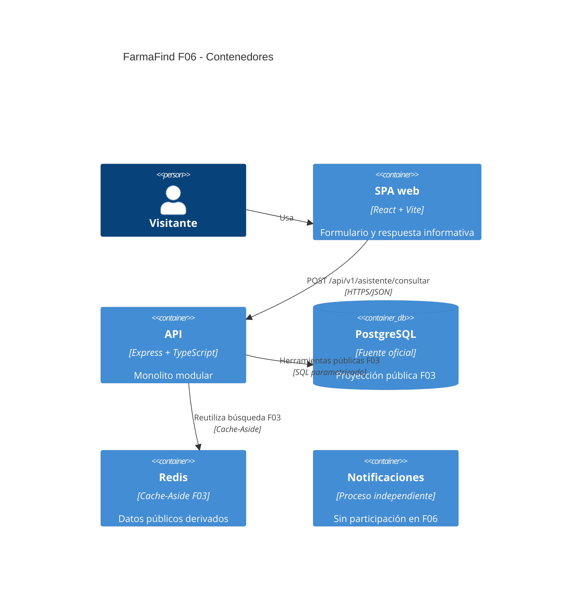

# C4 F06 — Contenedores y componentes

Dentro de API, `AIQueryOrchestrator` depende de `AIProvider` y `PublicKnowledgeTools`.
`MockAIProvider` implementa el primer puerto; las herramientas adaptan casos F03 de solo
lectura. No hay conexión desde F06 a tablas privadas ni a proveedores externos.
